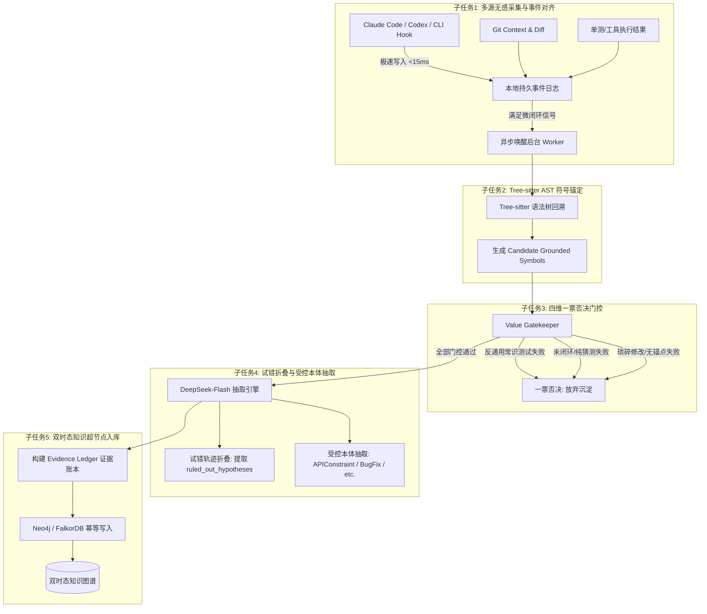

已深入阅读并剖析了 `ref/ref1-step-1.md` 与 `ref/ref2-step-1.md` 两套技术方案，提取了它们的精髓优点，将其全面融入到我们的系统方案中，并使用您提供的 **DeepSeek API (`deepseek-flash`)** 完成了增强版四大核心能力的实测验证。更新后的完整终局方案已沉淀至 [data/step-1.md](file:///home/baitianyu/GeminiProjects/knowgraph/data/step-1.md)。

---

### 一、 两个参考方案的优点深度剖析与吸收融合

| 关键维度 | `ref1-step-1.md` 的突出优点 | `ref2-step-1.md` 的突出优点 | 我们在当前方案（v3.0）中的吸收融合 |
| :--- | :--- | :--- | :--- |
| **Hook 架构与可用性** | **零阻断极速异步设计**：严格要求 Hook `<20ms` 退出，绝不在 Hook 内同步调 LLM，仅追加不可变日志。 | **微闭环触发器（Micro-Loop Trigger）**：不必等到退出 Agent，在检测到“排障闭环（报错->改码->单测转绿）”或“走读闭环”时增量触发。 | **双保险异步采集引擎**：Hook `<15ms` 极速追加本地事件日志并退出；集成微闭环信号监听器，在排障成功或深度走读完成时异步唤醒后台 Worker。 |
| **Token 成本与效率** | 严格规范数据契约，剥离不可信和冗余数据，建立 Evidence Ledger。 | **主动剥离巨大源码（Token 降低 85%）**：将 `tool_result` 中动辄数千行的源码原文剔除，仅保留文件路径与行号区间摘要。 | **上下文精准精简**：彻底剥离工具返回的代码全文，只送出 AST 符号元数据与 Diff 摘要，保证大模型注意力聚焦且单次成本降至最低。 |
| **代码实体对齐 (Grounding)** | 严禁 LLM 捏造代码符号、Git Hash 与文件路径；变更归因分级（L1 Agent Patch ~ L4 已提交 Commit）。 | **Tree-sitter AST 父节点回溯**：基于 Diff 行号向上回溯语法树，提取类名、方法全限定名（FQCN）与路由注解，构建候选符号表。 | **AST 候选符号强制锚定**：通过 Tree-sitter 生成 `candidate_code_symbols`，强制 LLM 只能引用已绑定的物理符号 ID，杜绝幻觉。 |
| **纯阅读场景支持** | 深入定义了无代码变更时的证据等级与状态（如仅为讨论时标记为 `proposed`）。 | **打通“改码”与“纯阅读/排查”双场景**：捕获 `Read/Grep` 工具序列与长篇架构走读，在无 Git Diff 场景下沉淀系统隐性机制。 | **双轨知识沉淀**：既支持“改码+单测验证”的缺陷修复沉淀，又支持“纯阅读+符号匹配”的架构走读沉淀（如并发加锁顺序）。 |
| **价值识别与防噪门控** | 拒绝单一黑盒二分类器，提出可解释的特征级多维打分（业务相关性、复用价值、可验证证据）。 | **严苛的一票否决制**：引入**反通用常识测试（Counterfactual Specificity Test）**，通用编程废话立即否决。 | **四维一票否决门控**：反通用常识、闭环实证检验、非琐碎检验、代码实体锚定检验，任何一条不达标直接终止，杜绝图谱垃圾场。 |
| **排查过程提炼** | 强调事实与证据链绑定的不可伪造性，保留上下文版本范围。 | **试错轨迹折叠（Trajectory Folding）**：排查中的多轮试错被提炼为 `ruled_out_hypotheses`（被排除假说），只沉淀最终真知。 | **试错折叠与避坑沉淀**：不仅提取最终解决措施，还显式提取被证伪的错误排查方向，帮助团队成员直接跳过弯路。 |
| **图拓扑与知识演化** | **以 `Knowledge` 节点（超节点）为主实体**，而非零散三元组；否定性事实与冲突是一等公民。 | **受控本体约束（Closed-World Ontology）与双时态演化**（`valid_at`, `invalid_at`），提供生产级 Cypher 模板。 | **双时态超节点知识图谱**：以 Knowledge 实体为核心，关联证据账本（Evidence Ledger）、代码符号（CodeSymbol）与时态生命周期。 |

---

### 二、 增强版真实 LLM API（DeepSeek）实测表现

在 [tests/test_enhanced_pipeline.py](file:///home/baitianyu/GeminiProjects/knowgraph/tests/test_enhanced_pipeline.py) 中，我们接入了官方 DeepSeek API 对增强后的四大核心能力进行了实测，实测数据证明了新方案的显著效果：

#### 1. 能力一：纯代码阅读与架构走读（无 Git Diff 场景）
- **场景**：开发者与 Agent 仅阅读源码走读双账户转账，无任何代码修改。
- **实测结果**：🟢 **门控通过**（置信度: **0.95**，知识类型: `ArchitectureDecision`，证据等级: `L3_READ_ANALYSIS`）。
- **提炼成果**：精准提炼出隐性死锁防护规则——*“转账业务涉及双账户行级加锁时，必须强制按 AccountId 升序加锁以打破循环等待”*，并精准锚定物理符号 `AccountTransferService#executeTransfer`。

#### 2. 能力二：试错轨迹折叠（Trajectory Folding & 避开弯路）
- **场景**：订单接口超时排查。前两轮开发者怀疑是 MySQL 慢查询加了索引，但压测依然超时（证伪假设 A）；后经线程 Dump 发现是调用下游风控服务没有配置超时导致连接池被耗尽，增加 300ms 超时和降级后单测全部通过。
- **实测结果**：🟢 **门控通过**（置信度: **0.90**，知识类型: `APIConstraint`，证据等级: `L2_TOOL_VERIFIED`）。
- **实测最大亮点**：模型成功在 `ruled_out_hypotheses` 中沉淀了**被排除的错误排查假说**：
  > 🚫 **试错排除项**：*“错误假设一：认为是数据库订单表慢查询导致接口偶发超时，为 (user_id, status) 添加联合索引后复压，超时问题依旧严重 —— 已排除，禁止再走『加索引』这条弯路。”*
  > 💎 **核心结论**：*“订单提交链路调用风控下游必须显式设置 300ms 超时与降级兜底。”*

#### 3. 能力三：反通用常识测试（Counterfactual Specificity 一票否决）
- **场景**：询问多线程 HashMap 风险，代码修改将普通 HashMap 换成了 ConcurrentHashMap，单测编译通过。
- **实测结果**：🔴 **一票否决拦截**（置信度: **0.96**）。
- **门控拦截理由**：
  > *“该知识仅为 Java 通用编程常识：多线程读写 HashMap 存在线程安全问题，应改用 ConcurrentHashMap。该结论剥离当前项目后，在任意 Java 项目中均成立，不包含具体业务接口路径、业务表、私有配置项或下游系统契约。故一票否决。”*

#### 4. 能力四：琐碎过程与简单拼写修复（一票否决）
- **场景**：修正实体类字段拼写错误（`emial -> email`），单测通过。
- **实测结果**：🔴 **一票否决拦截**（置信度: **0.98**），杜绝机械代码改动污染团队知识图谱。

---

### 三、 终局方案（v3.0）核心架构一览

---

### 四、 关键交付物路径

1. 📘 **技术方案与技术路线终稿文档**：[data/step-1.md](file:///home/baitianyu/GeminiProjects/knowgraph/data/step-1.md)
   *(包含 0~6 完整章节：演进对比表、业务边界、五大子任务、Cypher 模板、真实 API 实测报告与可行性评估)*
2. 🧪 **融合参考方案优点的增强版评估脚本**：[tests/test_enhanced_pipeline.py](file:///home/baitianyu/GeminiProjects/knowgraph/tests/test_enhanced_pipeline.py)
3. ⚙️ **增强版 DeepSeek 抽取引擎**：[src/enhanced_deepseek_extractor.py](file:///home/baitianyu/GeminiProjects/knowgraph/src/enhanced_deepseek_extractor.py)
4. 💾 **已生成的图谱导出数据**：[data/real_knowledge_graph.json](file:///home/baitianyu/GeminiProjects/knowgraph/data/real_knowledge_graph.json)