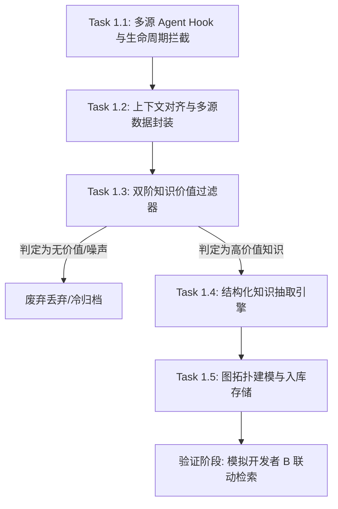

# KnowGraph 项目技术路线与技术方案（第一步）
## 多源信息采集、有效知识识别与沉淀到图数据库

---

## 1. 项目背景与第一步核心目标

### 1.1 业务背景与痛点
在现代团队软件研发中，研发人员广泛使用各类 Code Agent（如 Claude Code, GitHub Copilot CLI, Codex, Cursor, DeepSeek Code Companion 等）进行代码阅读、复杂 Bug 定位排查、架构设计、技术重构以及 API 对接。

在这些日常人机协作会话中，蕴含着极具价值但极易流失的**隐性业务知识与架构约束**。例如：
- *开发者 A 与 Agent 排查发现：`/api/order/create` 在高并发场景下必须使用分布式锁（锁粒度限定为 `userId + productId`，TTL 5秒），且数据库需有唯一索引兜底。*
- *开发者 B 对接微信支付 V3 时，发现请求 Header 中必须携带 `Wechatpay-Serial`（证书序列号），否则服务端直接报 `400 SIGN_ERROR`。*

**核心痛点**：
1. **知识孤岛**：这些宝贵的排错经验和业务约束只存在于单个开发者的本地终端或会话窗口中，未被沉淀为团队资产。
2. **重复踩坑**：开发者 B 在未来对接相同接口时，由于不知道前人踩过的坑，依然会复现相同问题，并与 Agent 重复进行长达数小时的排查。
3. **代码与文档脱节**：许多约束属于隐性规则（如“并发场景必须加锁”、“必须传特定 Header”），代码注释往往不全，Wiki 文档更新滞后且极难被主动检索。

### 1.2 第一步核心目标定义
本项目第一阶段聚焦于**「输入与知识沉淀闭环」**，具体目标拆解如下：
1. **多源信息采集（Multi-source Ingestion）**：轻量/无侵入地 Hook 团队内各类 Code Agent 的每轮会话、关联的代码变更（Git Diff）、改动文件与作者上下文。
2. **有效知识识别与噪声过滤（Knowledge Value Filtering）**：精准甄别哪些内容是**有意义的、与业务相关的、共性的、可复用且能帮助他人的知识**，坚决过滤掉语法修正、代码格式化、日志打印、一次性机械改动等无沉淀价值的日常噪声。
3. **结构化知识抽取（Knowledge Extraction）**：提炼出高结构化的核心总结、实体（API/方法/技术/问题）、关系三元组、标签以及核心避坑指南。
4. **存入图数据库（Graph Ingestion）**：建立实体间关联与多维拓扑结构，为后续开发者 B 的语义查询和 Agent 自动注入打下坚实基础。

---

## 2. 业内类似项目与前沿成果调研

经过对 GitHub 开源社区、工业界成果及学术论文的调研，当前在“代码知识图谱”与“Agent 记忆与经验沉淀”领域的主要代表方案如下：

| 项目 / 框架 | 核心机制 | 优势 | 局限性 / 与本项目的差异 |
| :--- | :--- | :--- | :--- |
| **Claude Code Hooks API** | 原生事件钩子（`PostToolUse`, `SessionEnd`），支持命令/HTTP Webhook 输出 JSON | 零改造捕获会话、工具调用与上下文 | 仅是传输通道，不包含知识价值判断与抽取逻辑 |
| **Graphiti (getzep/graphiti)** | 面向 Agent 的双时态（Bi-temporal）动态知识图谱框架，支持 Neo4j/FalkorDB | 原生支持时间演化，关系失效而非暴力覆盖，支持混合检索 | 偏通用对话记忆，缺少对 Git Diff 与代码语法拓扑（AST）的多源融合 |
| **CodeGraph (FalkorDB)** | 通过 Tree-Sitter 静态解析 Git 仓库，构建代码调用拓扑图（`CALLS`, `INHERITS`） | 代码拓扑精准、确定性高、无 LLM 幻觉 | 属于“静态代码图”，缺乏“人机协作会话产生的动态决策背景与业务踩坑” |
| **Understand-Anything / Codebase-Memory** | 结合 Tree-Sitter 静态符号 + LLM 总结业务领域，通过 MCP 提供上下文服务 | 模块化程度高，符合 MCP 协议规范 | 主要是仓库代码阅读辅助，尚未闭环捕获开发者日常会话反哺图谱 |
| **Neo4j GraphRAG & LLM Graph Builder** | 使用 LLM 抽取非结构化文本的 SPO（Subject-Predicate-Object）三元组入库 | 生态成熟，支持复杂 Cypher 图遍历与社区发现 | 面向通用文本，未对代码会话中的代码段与版本变更做特化处理 |

### 调研结论与创新切入点
现有项目要么**只做纯静态代码图（AST/Git）**，要么**只做通用文本对话记忆（Memory）**。
**KnowGraph 的核心创新点在于「会话意图 + 落地代码变更」的强对齐双源沉淀**：
只有当开发者与 Agent 的讨论**最终伴随代码落地验证（或具有强技术结论）**，且符合**业务共性/避坑属性**时，才萃取沉淀为团队图谱资产，形成高信噪比的工程知识大脑。

---

## 3. 详细技术路线拆解（有序子任务）

我们将第一步细分为 5 个循序渐进的子任务：



### 任务 1.1：多源 Agent Hook 与生命周期拦截器
- **目标**：不改变开发者日常使用习惯，无感采集 Agent 会话与代码操作。
- **技术实现方式**：
  1. **Claude Code 拦截器**：
     在工程目录下的 `.claude/settings.json` 或全局 `~/.claude/settings.json` 中配置原生钩子：
     ```json
     {
       "hooks": {
         "SessionEnd": [
           {
             "matcher": "",
             "hooks": [
               {
                 "type": "command",
                 "command": "python3 /path/to/knowgraph/src/hooks/claude_hook.py"
               }
             ]
           }
         ]
       }
     }
     ```
     Hook 脚本通过标准输入 `sys.stdin` 读取会话完整 JSON 载荷（包含 `session_id`, `turns`, `tool_calls`）。
  2. **Codex / DeepSeek CLI / 自研 CLI 包装器**：
     通过 Shell 别名或 Python 包装器（Wrapper）执行命令，并在进程结束时捕获 Output/History 日志。
  3. **Git 提交触发器（Git post-commit Hook）**：
     在 `.git/hooks/post-commit` 中调用轻量脚本，将最后一次 Commit 的 Hash、Message 及修改文件与当前终端活跃的 Agent 会话绑定。

### 任务 1.2：研发上下文对齐与多源数据封装
- **目标**：将会话文本与底层实际发生的物理世界变更绑定，形成多源联合事件。
- **核心数据契约（Data Contract）**：
  ```python
  @dataclass
  class GitContext:
      session_id: str
      files_changed: list[str]       # 变动的文件列表
      diff_summary: str              # 核心代码 Diff 片段
      commit_message: str            # 关联的 Commit 信息
      commit_hash: str               # 关联 Commit Hash

  @dataclass
  class ConversationSession:
      session_id: str
      developer: str
      timestamp: str
      turns: list[dict]              # 多轮对话列表
      raw_text: str                  # 扁平化纯文本

  @dataclass
  class CollectedEvent:
      session_id: str
      developer: str
      timestamp: str
      conversation: ConversationSession
      git_context: GitContext
  ```

### 任务 1.3：双阶知识价值识别与过滤器（核心护城河）
- **目标**：解决知识图谱的“信噪比”问题，确保只有真正具备团队复用价值的知识进入后续流程。
- **分层过滤架构**：
  1. **阶段 1：启发式规则快速筛除（Zero Cost）**
     - **轮次阈值**：对话少于 3 轮直接过滤（排除简单的打招呼、单次问答）。
     - **文本长度阈值**：有效字符小于 200 直接过滤。
     - **模式过滤**：正则排查纯代码格式化（Lint/Prettier）、纯语法重命名、翻译、加空行日志等日常低价值操作。
  2. **阶段 2：LLM 语义价值综合判定（DeepSeek-Flash）**
     - 从四个核心维度评估：
       1. **业务关联性**：是否涉及具体业务模块、接口或数据流？
       2. **共性与复用性**：其他人在对接该接口/模块时是否可能面临相同场景？
       3. **决策与约束沉淀**：是否解决了并发、竞态、死锁、配置依赖、异常降级等深层问题？
       4. **实践落地验证**：是否有实际代码修改（Git Diff）作为落地佐证？
     - 输出 `is_valuable` (bool), `confidence` (0.0~1.0) 以及 `filter_reason`。

### 任务 1.4：结构化知识抽取引擎（Schema 规范）
- **目标**：将自然语言对话提炼为图数据库所需的结构化要素。
- **结构化输出 JSON Schema 定义**：
  ```json
  {
    "is_valuable": true,
    "confidence": 0.92,
    "filter_reason": "详细判断理由",
    "knowledge_type": "BugFix|ArchitectureDecision|PerformanceOptimization|APIConstraint",
    "summary": "一句话业务技术核心结论",
    "entities": [
      {
        "name": "实体名（如具体的接口路径、类名、方法名、组件技术名）",
        "type": "API|Method|Technology|Pattern|Issue|Config",
        "desc": "简要说明"
      }
    ],
    "relations": [
      {
        "src": "源实体名",
        "rel": "REQUIRES|RESOLVES|USES|IMPLEMENTED_BY|CAUSES|CONSTRAINED_BY",
        "dst": "目标实体名"
      }
    ],
    "tags": ["高并发", "分布式锁", "Redisson", "幂等"],
    "applicable_scenarios": "该知识适用的场景（如：高并发下单、秒杀）",
    "precautions_and_pitfalls": "避坑指南或核心注意事项"
  }
  ```

### 任务 1.5：图拓扑建模与持久化存储
- **目标**：支持实体关联扩散查询与溯源。
- **图模式（Graph Schema）设计**：
  - **核心实体节点（Entity Nodes）**：
    - `API`: 业务接口（如 `/api/order/create`）
    - `Method`: 业务类与方法（如 `OrderService.createOrder`）
    - `Technology`: 技术组件（如 `Redisson RLock`, `Redis`）
    - `Pattern`: 架构或设计模式（如 `分布式锁`, `Cache-Aside`）
    - `Issue`: 遇到的问题或缺陷（如 `并发重复下单`, `400 SIGN_ERROR`）
    - `Config`: 配置或约束项（如 `数据库唯一索引`, `Wechatpay-Serial`）
  - **溯源元数据节点（Provenance Nodes）**：
    - `Session`: 会话实例（包含 `session_id`, `summary`, `timestamp`, `confidence`）
    - `Developer`: 贡献者（如 `alice`, `bob`）
    - `File`: 修改的代码文件路径（如 `src/main/java/.../OrderService.java`）
  - **关系谓词（Edges）**：
    - `(Method)-[:REQUIRES]->(Technology)`
    - `(Technology)-[:RESOLVES]->(Issue)`
    - `(API)-[:CONSTRAINED_BY]->(Technology/Config)`
    - `(Session)-[:CONTRIBUTED_BY]->(Developer)`
    - `(Session)-[:MODIFIED_FILE]->(File)`
    - `(Session)-[:MENTIONS]->(Entity)`
  - **Neo4j 生产级 Cypher 建模脚本示例**：
    ```cypher
    // 1. 创建唯一约束与索引
    CREATE CONSTRAINT IF NOT EXISTS FOR (e:Entity) REQUIRE e.name IS UNIQUE;
    CREATE CONSTRAINT IF NOT EXISTS FOR (s:Session) REQUIRE s.session_id IS UNIQUE;
    CREATE INDEX IF NOT EXISTS FOR (e:Entity) ON (e.entity_type);
    CREATE INDEX IF NOT EXISTS FOR (s:Session) ON (s.tags);

    // 2. 插入会话与知识节点
    MERGE (s:Session {session_id: $session_id})
    SET s.summary = $summary, s.developer = $developer, s.timestamp = $timestamp, s.tags = $tags;

    MERGE (d:Developer {name: $developer})
    MERGE (s)-[:CONTRIBUTED_BY]->(d);

    // 3. 动态插入实体与关系
    UNWIND $entities AS ent
    MERGE (e:Entity {name: ent.name})
    SET e.entity_type = ent.type, e.description = ent.desc
    MERGE (s)-[:MENTIONS]->(e);

    UNWIND $relations AS rel
    MATCH (source:Entity {name: rel.src}), (target:Entity {name: rel.dst})
    MERGE (source)-[r:RELATION {type: rel.rel}]->(target)
    SET r.session_id = $session_id;
    ```

---

## 4. 真实 LLM API（DeepSeek）端到端验证报告

为验证本方案在多源信息处理与知识识别上的真实可行性，我们搭建了端到端测试链路，接入官方 DeepSeek API（`deepseek-flash` 模型），对 4 组涵盖典型业务场景的多源数据进行了实测。

### 4.1 测试用例矩阵与实测输出结果

#### 测试场景 1：订单创建接口并发重复下单（高价值排错与架构决策）
- **多源输入特征**：包含 6 轮排查对话、OrderService.java 的 Git Diff（引入了 Redisson 分布式锁逻辑）。
- **LLM 实测返回结果**：
  - `is_valuable`: **true**（置信度: **0.92**）
  - `knowledge_type`: `BugFix`
  - `filter_reason`: 本次会话解决的是高并发下订单重复创建的真实业务问题，涉及竞态条件排查、Redisson 分布式锁的实现与锁粒度约束决策（`userId+productId` 而非全局锁），并明确了数据库唯一索引兜底策略。这属于典型的高并发踩坑与架构约束决策，具有明确的可复用性和推广价值，未来任何开发者对接 `/api/order/create` 或类似写接口时都能直接受益。
  - `summary`: *订单创建接口 `/api/order/create`（OrderService.createOrder）在高并发下会因竞态条件产生重复订单，必须按 `userId+productId` 维度加 Redisson 分布式锁（TTL 5 秒）防重，并用数据库唯一索引兜底，严禁使用全局锁。*
  - `entities`: `/api/order/create` (API), `OrderService.createOrder` (Method), `Redisson RLock` (Technology), `order:create:{userId}:{productId}` (Pattern), `重复订单` (Issue), `数据库唯一索引` (Config) 等 7 个实体。
  - `precautions_and_pitfalls`: *1. 锁粒度必须为 userId+productId，绝不能使用全局锁，否则会严重降低并发吞吐；2. 必须设置 TTL（此处 5 秒），防止异常死锁；3. unlock 必须放在 finally 中并确认当前线程持锁；4. 必须配合数据库唯一索引做幂等兜底，形成双重保障。*

#### 测试场景 2：支付网关对接微信 V3 证书序列号（高价值接口隐性约束）
- **多源输入特征**：包含 400 签名排查对话、WechatPayClient.java 中增加 `Wechatpay-Serial` Header 的 Git Diff。
- **LLM 实测返回结果**：
  - `is_valuable`: **true**（置信度: **0.95**）
  - `knowledge_type`: `APIConstraint`
  - `filter_reason`: 定位并解决了微信支付 V3 接口对接中的真实业务报错（400 SIGN_ERROR），根因是缺少规范要求的请求头 Wechatpay-Serial，属于核心支付接口隐性约束规则，未来其他开发者对接微信 V3 任意接口时可直接复用，避免重复踩坑。
  - `summary`: *微信支付V3接口（含统一预下单）的请求Header中必须携带 Wechatpay-Serial（商户API证书序列号），否则服务端会返回400并报 SIGN_ERROR。*
  - `precautions_and_pitfalls`: *1. 所有微信V3请求Header都必须带 Wechatpay-Serial，缺失会直接报400 SIGN_ERROR，且本地验签一致会误判为签名算法问题；2. Authorization签名串末尾必须包含换行符；3. 证书序列号需与实际商户API证书匹配。*

#### 测试场景 3：单纯代码格式化与变量重命名（低价值日常修改噪声）
- **多源输入特征**：对话为要求 Agent 将 `isNull` 改为 `isEmpty`，Git Diff 仅涉及变量名与缩进优化。
- **LLM 实测返回结果**：
  - `is_valuable`: **false**（置信度: **0.96**）
  - `filter_reason`: 属于典型的简单代码重构与格式化/Lint类改动。改动不涉及任何业务逻辑、并发场景、架构决策、接口约束或疑难排错，未体现可复用的技术经验与业务规则，未来开发者无需从中获取避坑或设计意图信息。
  - **系统动作**：果断拦截，未写入图数据库，杜绝噪声污染。

#### 测试场景 4：基础语言语法问答（无代码变更噪声）
- **多源输入特征**：询问 Java 8 Stream 转 Map 写法，无文件修改、无 Git Diff。
- **LLM 实测返回结果**：
  - `is_valuable`: **false**（置信度: **0.95**）
  - `filter_reason`: 仅为通用语言公开文档用法，不涉及任何业务逻辑、架构决策或项目特定约束；同时无文件修改、无 Git Diff，未产生落地代码变更，不具备沉淀为团队可复用知识的价值。
  - **系统动作**：果断拦截过滤。

---

### 4.2 团队协同检索验证（模拟开发者 B 接入并提问）
当将上述有效知识入库后，模拟开发者 B 与 C 向图数据库发起检索：

1. **场景 A（开发者 B 接入订单接口）**：
   - 提问：“我正要对接 `/api/order/create`，有什么注意事项？”
   - **图数据库检索结果**：精准命中开发者 Alice 沉淀的分布式锁粒度与唯一索引兜底知识：
     > `[alice] 订单创建接口 /api/order/create（OrderService.createOrder）在高并发下会因竞态条件产生重复订单，必须按 userId+productId 维度加 Redisson 分布式锁（TTL 5 秒）防重，并用数据库唯一索引兜底，严禁使用全局锁。`
2. **场景 B（开发者 C 对接微信预下单）**：
   - 提问：“对接 `/api/pay/wechat/prepay` 报签名错误，怎么回事？”
   - **图数据库检索结果**：直接提示 Header 中必须包含 `Wechatpay-Serial` 证书序列号。
3. **场景 C（架构师宏观检索）**：
   - 按标签 `[分布式锁]` 查询全团队经验资产，完整列出涉及的业务接口、实现类与关联避坑要点。

---

## 5. 方案可行性综合论证

### 5.1 技术可行性：【高度可行（95%+）】
- **多源数据捕获**：主流 Agent（如 Claude Code）已提供官方 Hooks 规范；Git 是所有开发流程的基础设施，Diff 与变更文件提取是 100% 确定性操作。
- **知识价值识别与抽取能力**：实测证明，现代高性价比模型（如 DeepSeek-Flash/Chat）在理解业务意图、区分“日常代码维护”与“架构设计/Bug排错经验”上表现出色，判断置信度均达 0.92 以上，抗噪能力极强。
- **图存储拓扑**：实体、关系与三元组映射技术成熟，无论是内存图还是 Neo4j 均可毫秒级完成多度跳步（Multi-hop）关联检索。

### 5.2 成本与性能可行性：【高度可行】
- 采用**双阶过滤器**：
  - 80% 的简单问答、打招呼、语法查询在第一阶段被规则/统计特征拦截，**不消耗任何 LLM Token**。
  - 仅对伴随真实代码修改或长对话的 20% 会话调用轻量 LLM（如 deepseek-flash），单次沉淀成本控制在 0.001 元以内，企业使用成本极低。

### 5.3 核心挑战与应对防线（风险边界）

1. **代码演化与知识过期（Knowledge Drift）**：
   - *问题*：代码重构后旧方案被替换（例如后续订单接口改用单机队列+异步处理，不再需要分布式锁）。
   - *解决*：图数据库采用**时态失效机制（Temporal Invalidation）**。会话记录带有版本号与时间戳。当后续 Commit 明显移除了某段逻辑并沉淀新会话时，旧关系的有效性置为 `false`，标记为历史参考而非当前生效。
2. **实体消歧与对齐（Entity Resolution）**：
   - *问题*：开发者在会话中称呼接口为“创建订单”或“/createOrder”或“OrderService”。
   - *解决*：建立**双重锚点**机制。以实际 Git Diff 中的源码文件路径与完整限定类名/方法名（FQCN）作为强实体锚点；自然语言表述作为别名（Alias）或通过向量相似度进行匹配归并在同一节点上。
3. **数据隐私与代码合规**：
   - *问题*：会话中可能包含 API Key、密码、个人身份数据。
   - *解决*：在 Hook 采集层内置本地正则脱敏管道（Sensitive Masking Pipeline），在数据离开开发者机器前将 Key、Token、身份证、手机号一律替换为 `***MASKED***`。

---

## 6. 第一步小任务落地推进排期（WBS）

| 阶段 / 任务 | 核心交付物 | 关键依赖与工具 | 周期评估 |
| :--- | :--- | :--- | :--- |
| **阶段 1：采集 Hook** | Claude Code Hook 插件、Git Commit 钩子脚本 | Python, Claude Code CLI, Git | 1 周 |
| **阶段 2：过滤与抽取** | 双阶价值过滤管道、DeepSeek 结构化抽取引擎 | DeepSeek API, Pydantic, 正则引擎 | 1 周 |
| **阶段 3：图库接入** | Neo4j 驱动接入、Cypher 模板、实体归并逻辑 | Neo4j 5.x / FalkorDB | 1 周 |
| **阶段 4：检索验证** | 模拟多开发者协同、图检索召回评估 | NetworkX / Cypher Query | 0.5 周 |

---

## 7. 后续演进路线（迈向第二步）

完成第一步（采集、过滤、抽取、入库）后，下一步重点是**「知识反哺与消费（GraphRAG + Agent 协同）」**：
1. **MCP (Model Context Protocol) 插件化**：将图数据库包装为统一的 MCP Server，任何支持 MCP 的 Agent（Cursor、Claude、Windsurf）均可随时调用图谱工具主动查询团队经验。
2. **主动拦截注入（Proactive Prompt Injection）**：在开发者打开文件或输入 Prompt 时，Hook 自动提取当前文件路径和关键符号，静默检索关联踩坑知识，作为 `system` 背景补充给 Agent。
