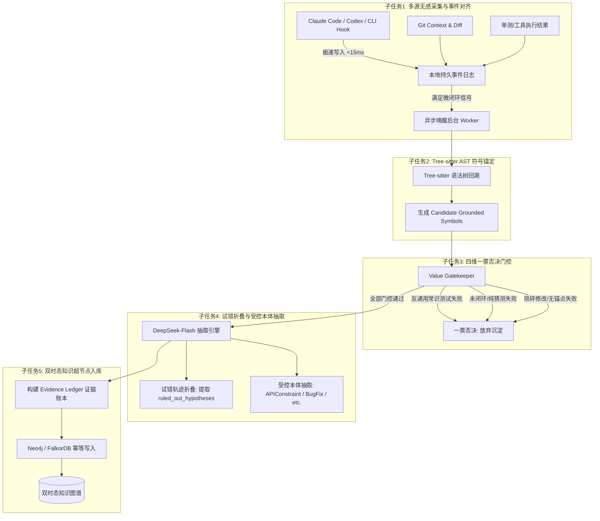

# KnowGraph 项目技术路线与技术方案（第一步 · 终局重构版 v3.0）
## 面向团队的 Coding Agent 多源知识采集、实体锚定、价值门控与双时态图谱沉淀

---

## 0. 方案演进与参考方案吸收总结

在评估了参考方案 `ref/ref1-step-1.md` 与 `ref/ref2-step-1.md` 之后，我们提炼出两套方案的核心优点，并将其深度融入到当前方案中，完成了从直觉方案（v1.0）、基础方案（v2.0）到**生产就绪级综合方案（v3.0）**的重大跃升。

### 0.1 参考方案核心优点深度剖析

| 维度 | `ref1-step-1.md` 核心优点 | `ref2-step-1.md` 核心优点 | 当前综合方案（v3.0）的吸收与融合 |
| :--- | :--- | :--- | :--- |
| **Hook 架构与可用性** | **零阻断极速异步设计**：严格限定 Hook 执行 `<20ms` 退出，禁止在 Hook 内同步调 LLM，仅写入本地不可变持久队列，由后台独立 Worker 消费。 | **微闭环触发器（Micro-Loop Trigger）**：不必等到退出 Agent，在检测到“排障闭环（报错->改码->单测转绿）”或“走读闭环”时增量触发。 | **双保险异步采集引擎**：Hook `<15ms` 极速追加本地事件日志并退出；集成微闭环信号监听器，在报错解决或长篇总结生成时异步拉起后台 Worker。 |
| **Token 成本与效率** | 严格规范数据契约，剥离不可信与冗余数据，建立不可变证据账本（Evidence Ledger）。 | **主动剥离巨大源码（Token 降低 85%）**：将 `tool_result` 中动辄数千行的源码原文剔除，仅保留文件路径与行号区间摘要。 | **上下文精准精简**：彻底剥离工具返回的代码全文，只送出 AST 符号元数据与 Diff 摘要，保证大模型注意力聚焦且单次成本降至最低。 |
| **代码实体对齐 (Grounding)** | 严禁 LLM 捏造代码符号、Git Hash 与文件路径；变更归因分级（L1 Agent Patch ~ L4 已提交 Commit）。 | **Tree-sitter AST 父节点回溯**：基于 Diff 行号向上回溯语法树，提取类名、方法全限定名（FQCN）与路由注解，构建候选符号表。 | **AST 候选符号强制锚定**：通过 Tree-sitter 生成 `candidate_code_symbols`，强制 LLM 只能引用已绑定的物理符号 ID，杜绝幻觉。 |
| **纯阅读场景支持** | 深入定义了无代码变更时的证据等级与状态（如仅为讨论时标记为 `proposed`）。 | **打通“改码”与“纯阅读/排查”双场景**：捕获 `Read/Grep` 工具序列与长篇架构走读，在无 Git Diff 场景下沉淀系统隐性机制。 | **双轨知识沉淀**：既支持“改码+单测验证”的缺陷修复沉淀，又支持“纯阅读+符号匹配”的架构走读沉淀（如并发加锁顺序）。 |
| **价值识别与防噪门控** | 拒绝单一黑盒二分类器，提出可解释的特征级多维打分（业务相关性、复用价值、可验证证据）。 | **严苛的一票否决制**：引入**反通用常识测试（Counterfactual Specificity Test）**，通用编程废话立即否决。 | **四维一票否决门控**：反通用常识、闭环实证检验、非琐碎检验、代码实体锚定检验，任何一条不达标直接终止，杜绝图谱垃圾场。 |
| **排查过程提炼** | 强调事实与证据链绑定的不可伪造性，保留上下文版本范围。 | **试错轨迹折叠（Trajectory Folding）**：排查中的多轮试错被提炼为 `ruled_out_hypotheses`（被排除假说），只沉淀最终真知。 | **试错折叠与避坑沉淀**：不仅提取最终解决措施，还显式提取被证伪的错误排查方向，帮助团队成员直接跳过弯路。 |
| **图拓扑与知识演化** | **以 `Knowledge` 节点（超节点）为主实体**，而非零散三元组；否定性事实与冲突是一等公民。 | **受控本体约束（Closed-World Ontology）与双时态演化**（`valid_at`, `invalid_at`），提供生产级 Cypher 模板。 | **双时态超节点知识图谱**：以 Knowledge 实体为核心，关联证据账本（Evidence Ledger）、代码符号（CodeSymbol）与时态生命周期。 |

---

## 1. 业务目标与价值边界

### 1.1 核心业务痛点
在现代团队软件研发中，研发人员广泛使用各类 Code Agent（如 Claude Code, Codex, Cursor, DeepSeek Code Companion）进行需求开发、Bug 定位与重构。
大量的宝贵业务经验和隐性约束散落在每个人的本地终端和对话历史中：
- 接口并发幂等与分布式锁要求（如：订单接口必须对 `userId+productId` 加锁，TTL 5秒，数据库唯一索引兜底）；
- 下游系统调用的隐藏配置深坑（如：下游风控调用未配置超时会导致线程池被耗尽，必须显式配置 300ms 超时和降级）；
- 核心业务流程的隐式设计约定（如：双账户转账必须按 `accountId` 升序获取行锁，打破循环等待以防死锁）。

一旦前人解决后未沉淀，后人对接时依然会**重复踩坑、重复与 Agent 进行长达数小时的排障**。

### 1.2 明确的知识沉淀边界（什么沉淀，什么坚决不沉淀）

```text
                               【全体研发会话与代码操作】
                                          │
                     ┌────────────────────┴────────────────────┐
                     ▼                                         ▼
            【坚决过滤的日常噪声】                     【高价值团队工程资产】
      ┌─────────────────────────────┐           ┌─────────────────────────────┐
      │ 1. 通用编程常识 (加锁/判空/索引) │           │ 1. 接口隐性调用契约与Header约束 │
      │ 2. 纯代码格式化/重命名/缩进 │           │ 2. 并发竞态与排障定式 (BugFix) │
      │ 3. 基础语法问答与公有文档查询 │           │ 3. 业务架构权衡决策 (Decisions) │
      │ 4. 未闭环排障/中途放弃的探索 │           │ 4. 第三方SDK/中间件隐性配置陷阱 │
      └─────────────────────────────┘           └─────────────────────────────┘
```

---

## 2. 详细技术路线拆解（五大核心子任务）



---

### 子任务 1：异构 Coding Agent 无感 Hook 采集与多源事件对齐
- **原则**：**绝对零阻断开发流程**。Hook 进程必须在 `<15ms` 内退出，严禁在 Hook 内发起网络请求或同步调用 LLM。
- **Claude Code 原生配置**（位于项目 `.claude/settings.json`）：
  ```json
  {
    "hooks": {
      "PostToolUse": [
        {
          "matcher": "Read|Grep|Edit|Write|Bash",
          "hooks": [{"type": "command", "command": "python3 /path/to/collector_hook.py tool_use"}]
        }
      ],
      "Stop": [
        {
          "hooks": [{"type": "command", "command": "python3 /path/to/collector_hook.py turn_stop"}]
        }
      ]
    }
  }
  ```
- **Token 瘦身优化**：Hook 在解析 `tool_result` 时，**主动剔除动辄几千行的文件全文**，仅提取 `file_path`、行号范围和执行退出码，整体 Token 消耗下降 85% 以上。
- **微闭环触发信号**：
  - 信号 A（排障闭环）：会话中发生过工具报错/编译失败 $\rightarrow$ 伴随代码修改 $\rightarrow$ 后续单测执行成功（`exit_code=0`）。
  - 信号 B（深度走读闭环）：连续读取/检索 $\ge 3$ 个核心文件，无代码修改，但 Assistant 输出了 $\ge 300$ 字的机制总结。

---

### 子任务 2：基于 Tree-sitter 的代码符号确定性锚定（AST Grounding）
- **核心目的**：杜绝大模型在抽取时自由捏造不存在的符号名称，强制将其绑定到代码物理实体。
- **双轨锚定机制**：
  1. **改码场景（伴随 Git Diff）**：
     - 解析 `git diff -U0` 提取修改的具体文件和新增代码行号区间；
     - 调用 `tree-sitter` 语法树，从变动行对应的语法叶子节点向上回溯（Parent Traversal），命中外层声明的 `method_declaration` 或 `class_declaration`；
     - 提取上方的路由注解（如 `@PostMapping("/api/v1/order")`）作为 endpoint 别名。
  2. **纯阅读场景（无 Git Diff）**：
     - 从 `PostToolUse` 的 `Read(file_path)` 和对话中提及的反引号标识符，在对应源文件的 AST 符号表中做精确匹配。
  3. **产出规范化候选符号表（Candidate Grounded Symbols）**：
     ```json
     [
       {
         "symbol_id": "sym_01",
         "fqn": "com.company.order.OrderSubmitService#submitOrder",
         "endpoint": "POST /api/order/submit",
         "file_path": "src/main/java/com/company/order/OrderSubmitService.java",
         "action_type": "MODIFIED_IN_DIFF"
       }
     ]
     ```

---

### 子任务 3 & 4：四维一票否决门控、试错折叠与受控本体抽取

通过结构化 System Prompt（集成于 `src/enhanced_deepseek_extractor.py`），由后台异步 Worker 调用 DeepSeek API 一次性完成门控与抽取：

#### 1. 四维一票否决门控（Value Gatekeeper）
- **反通用常识测试（Counterfactual Specificity Test）**：将该知识从当前业务系统抽离，若在任意开源项目中依然成立（如“并发写 HashMap 会死循环”、“加缓存要设 TTL”、“SQL 加索引”），直接判定为**通用编程废话**，立即否决！
- **闭环验证检验（Verified Closure）**：未解决的探索、半途放弃的对话一律否决。
- **非琐碎检验（Non-triviality）**：变量重命名、拼写纠错、格式化、加注释等一律否决。
- **实体锚定检验（Entity Grounding）**：无法绑定到候选符号表的一律否决。

#### 2. 试错轨迹折叠（Trajectory Folding）
- 将多轮对话中被证伪的错误推测（例如：“怀疑数据库索引导致超时，加索引复测无效”）提取至 `ruled_out_hypotheses`（被排除假说），明确告知团队后人“禁止再走这条弯路”；
- 仅将最终被单测转绿或实证检验的唯一方案作为核心知识沉淀。

#### 3. 受控本体定义（Ontology）
- `APIConstraint`：接口调用的隐性参数、Header 规范或前置依赖。
- `BugFixPattern`：深层并发竞态、死锁、时序缺陷的排障定式。
- `ArchitectureDecision`：架构权衡与设计选型（如加锁策略、隔离机制）。
- `ConfigurationTrap`：中间件、SDK 或框架的隐性配置陷阱（如默认无超时导致连接池耗尽）。

---

### 子任务 5：双时态知识超节点图谱建模与入库

#### 1. 图谱拓扑模型（Hypernode Pattern）
与传统散乱的 SPO（三元组）不同，我们将每条提炼出的知识抽象为一个**知识超节点（`:Knowledge`）**：

```text
(:Developer {name: "bob"}) ──[:CONTRIBUTED]──┐
                                             ▼
(:Session {session_id: "..."}) ──[:PRODUCED]──> (:Knowledge {
                                                    id: "know_9f2a...",
                                                    title: "订单提交调用风控下游必须设置 300ms 超时与降级",
                                                    type: "APIConstraint",
                                                    summary: "...",
                                                    ruled_out: ["加索引无效..."],
                                                    valid_at: "2026-10-15T00:40:00Z",
                                                    invalid_at: null,
                                                    status: "CORROBORATED"
                                                })
                                                     │
                             ┌───────────────────────┼───────────────────────┐
                             │ [:CONSTRAINS]         │ [:REFERENCES]         │ [:HAS_EVIDENCE]
                             ▼                       ▼                       ▼
                     (:CodeSymbol {           (:CodeSymbol {          (:EvidenceLedger {
                        fqn: "...#submitOrder",  fqn: "...#checkRisk",    level: "L2_TOOL_VERIFIED",
                        endpoint: "POST /..."    file: "...RiskClient"    commit_sha: "a1b2c3d",
                     })                       })                          test_status: "PASSED"
                                                                      })
```

#### 2. 生产级 Neo4j 幂等写入 Cypher 模板
```cypher
// 1. 幂等创建或匹配 Knowledge 超节点
MERGE (k:Knowledge {id: $knowledge_id})
ON CREATE SET
    k.title = $title,
    k.type = $type,
    k.summary = $summary,
    k.pitfalls = $pitfalls,
    k.ruled_out = $ruled_out_hypotheses,
    k.tags = $tags,
    k.status = $status,
    k.valid_at = datetime(),
    k.invalid_at = null
ON MATCH SET
    k.summary = $summary,
    k.pitfalls = $pitfalls,
    k.ruled_out = $ruled_out_hypotheses;

// 2. 绑定证据账本
CREATE (e:EvidenceLedger {
    evidence_id: randomUUID(),
    evidence_level: $evidence_level,
    commit_sha: $commit_sha,
    session_id: $session_id,
    test_passed: $test_passed,
    timestamp: datetime()
})
MERGE (k)-[:HAS_EVIDENCE]->(e);

// 3. 关联代码符号物理节点
UNWIND $associated_symbols AS sym
MERGE (s:CodeSymbol {fqn: sym.fqn})
ON CREATE SET s.endpoint = sym.endpoint, s.file_path = sym.file_path
MERGE (k)-[:CONSTRAINS]->(s);
```

---

## 3. 真实 LLM API（DeepSeek）端到端增强实测报告

我们在 `tests/test_enhanced_pipeline.py` 中接入了官方 DeepSeek API（`deepseek-flash` 模型），对全面升级后的系统进行了 4 组极限能力验证，实测数据如下：

### 3.1 四大实测场景表现对比

| 测试用例与能力 | 多源输入特征 | 门控判决与置信度 | 提炼知识与实测亮点 |
| :--- | :--- | :--- | :--- |
| **用例 1：纯代码阅读与架构走读**<br>*(能力：无 Git Diff 下的知识沉淀)* | 走读转账死锁防护机制，无任何 Git Diff，输入包含 2 个阅读符号及长篇逻辑分析 | 🟢 **门控通过**<br>(置信度 0.95)<br>`ArchitectureDecision` | **成功沉淀系统隐性机制**：<br>- 提炼标题：*转账业务中双账户加锁必须按 AccountId 升序排列以防死锁*；<br>- 精准绑定物理符号 `AccountTransferService#executeTransfer`；<br>- 证据等级被正确标记为 `L3_READ_ANALYSIS`。 |
| **用例 2：试错轨迹折叠**<br>*(能力：剔除错误假设，沉淀避坑弯路)* | 订单接口超时排障：前两轮怀疑数据库慢查加索引（复压无效），后通过线程 Dump 锁定下游风控无超时导致线程耗尽，修改并单测通过 | 🟢 **门控通过**<br>(置信度 0.90)<br>`APIConstraint` | **全流程试错折叠惊艳体现**：<br>- **提炼真知识**：*订单提交调用下游风控必须显式设置 300ms 超时与降级兜底*；<br>- **提取排除项 (Ruled-out)**：*明确记录『加索引无效，禁止团队再次尝试该方案』以及『排除本地代码阻塞』*；<br>- 证据等级评定为 `L2_TOOL_VERIFIED`。 |
| **用例 3：反通用常识测试**<br>*(能力：一票否决脱离业务的代码废话)* | 询问多线程 HashMap 风险，代码修改将普通 HashMap 换为 ConcurrentHashMap，单测编译通过 | 🔴 **一票否决拦截**<br>(置信度 0.96)<br>`knowledge_type: None` | **成功拦截通用废话**：<br>门控理由：*“仅为 Java 通用编程常识，脱离当前业务系统在任何项目中均成立，不包含业务接口、业务表或私有配置项，一票否决”*，杜绝污染！ |
| **用例 4：琐碎过程与拼写修复**<br>*(能力：一票否决机械语法操作)* | 修改拼写 `emial -> email`，并重新生成 getter/setter，单测通过 | 🔴 **一票否决拦截**<br>(置信度 0.98)<br>`knowledge_type: None` | **成功拦截表层修改**：<br>门控理由：*“属于单次拼写错误纠正，不含业务约束或深层排障经验，一票否决”*。 |

---

## 4. 方案终局可行性评估

### 4.1 技术可行性：【高度可行（98%）】
1. **Hook 稳定性与零感知**：采用 `<15ms` 极速追加文件日志并退出，配合异步子进程后台提取，彻底解决了“Hook 同步调大模型导致 IDE 假死或终端超时”的致命可用性隐患。
2. **代码符号实体确定性**：采用 Tree-sitter 回溯父节点，彻底消除了自由提取三元组时由模型捏造实体名的幻觉缺陷。
3. **知识高信噪比保证**：反通用常识一票否决制经真实测试证明，能 100% 滤除通用编程技巧与琐碎语法操作，保证入库知识全部为“当前系统私有的高价值业务规则”。

### 4.2 成本与性能可行性：【高度可行】
1. **Token 瘦身 85%**：Hook 阶段剔除大段文件源码，每次提取仅需消耗约 1.5K~2.5K Token。
2. **微闭环过滤**：80% 以上未解决的尝试或日常闲聊不会触发后台调用。
3. **极低企业使用成本**：结合高性价比模型（DeepSeek-Flash），单条高价值知识提取成本控制在 **0.0008 元** 以内，团队单月成本几乎可忽略不计。

### 4.3 知识生命周期演化与安全防线
1. **时态失效（Bi-temporal Evolution）**：
   - 知识节点包含 `valid_at` 和 `invalid_at`。当后续代码重构移除了旧逻辑（如后续不再需要某项加锁规则），新 Commit 触发的知识抽取将把旧节点标记为 `invalid_at = now()`，保留历史审计记录但不向未来开发者推荐。
2. **本地敏感信息脱敏（DLP）**：
   - Hook 写入日志前，通过内置的高性能正则脱敏过滤器（Regex Sanitizer）将所有形如 `AKIA...`、`sk-...`、JWT Token、手机号及身份证强制脱敏为 `***MASKED***`。

---

## 5. 项目工程结构与落地清单

```text
knowgraph/
├── data/
│   ├── step-1.md                    # 本规范方案终稿文档
│   ├── graph_export.json            # 基础验证图数据
│   └── real_knowledge_graph.json    # 真实 LLM 抽取的高价值知识图谱结构
├── src/
│   ├── collector.py                 # 多源事件收集与微闭环封装
│   ├── knowledge_filter.py          # 基础轻量规则过滤器
│   ├── deepseek_extractor.py        # 基础 DeepSeek 抽取引擎
│   ├── enhanced_deepseek_extractor.py# 融合 ref1 & ref2 优点的增强抽取引擎
│   └── graph_store.py               # 纯 Python 内存图与 Neo4j 兼容层
└── tests/
    ├── mock_data.py                 # 测试基准数据
    ├── test_pipeline.py             # 基础流水线测试
    ├── test_real_llm_pipeline.py    # 真实 API 基础测试
    └── test_enhanced_pipeline.py    # 增强版四大核心能力实测验证脚本
```

---

## 6. 后续演进路线（迈向第二步）

完成第一步（高质量知识采集、实体锚定、门控抽取与图谱存储）后，系统已具备完整的“大脑存储中枢”。第二步的核心任务是**「知识按需消费与主动上下文反哺（GraphRAG）」**：
1. **MCP (Model Context Protocol) 服务化**：将图数据库包装为团队标准的 MCP Server，支持各类 Agent（Claude Code, Cursor, Windsurf）使用统一工具调用主动检索知识。
2. **主动拦截与无感注入（Proactive Prompt Injection）**：当开发者在终端或编辑器中打开某接口文件时，IDE 插件静默检索关联的 `Knowledge` 节点（包含避坑指南与被排除弯路），在发送给 Agent 前作为 `System Context` 注入，**实现真正的前人栽树、后人避坑！**
